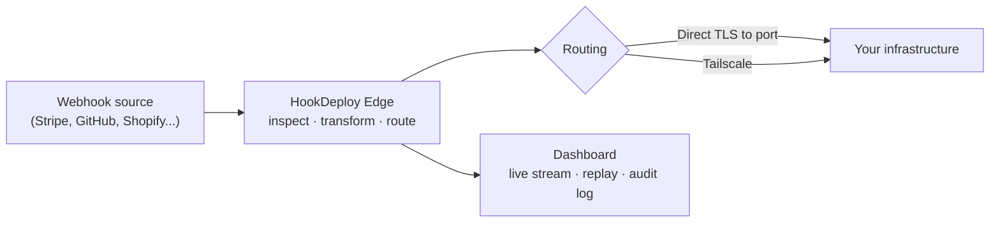

  

<h3 align="center">Webhooks hit our edge - the rest is private.</h3>

  
  
  

  
  
  

  
  

---

### What is HookDeploy?

HookDeploy is webhook infrastructure, not a debugging tool you bolt on afterward.

Webhooks land on our edge, get inspected, transformed, and routed — then delivered to your infrastructure through an encrypted private tunnel. Your servers never have to sit behind a public, internet-facing endpoint just to receive a webhook.

- **Inspect** every request — headers, body, query — in a live stream, no polling
- **Transform** payloads before they reach you, with a visual rule editor (same engine runs in preview and production — zero drift)
- **Route** to multiple destinations per endpoint, with retries and delivery tracking
- **Tunnel** straight into your private network over Tailscale, or forward directly to a port over TLS — skip the public ingress entirely
- **Replay** any captured request on demand, with full history
- **Verify** platform handshakes out of the box (Meta, Slack, Zoom) without writing the boilerplate yourself

### Why this exists

Webhook debugging is usually a black box: a provider fires a request, something goes wrong downstream, and you're left guessing what was actually sent. Most tools that "solve" this just give you a peek at the payload and call it a day.

HookDeploy treats the webhook hop as real infrastructure — observable, transformable, and able to reach private infrastructure without exposing it to the open internet in the first place.

### How it fits together

### Integrations

| Platform | Status |
|---|---|
| [n8n](https://github.com/hookdeploy/n8n-nodes-hookdeploy) | Public — this org |
| Zapier | Live |
| Make.com | Live |
| Power Automate | Planned |
| REST Hooks (custom) | Live — subscribe any URL |

### About this repo

The core platform — ingestion edge, transformation engine, relay infrastructure — is closed source; HookDeploy is a hosted product, not a self-hosted one. This repo is the public front door: where we ship integrations that *should* be open, point you to docs, and post what's changed.

**Watch → Releases** if you want update notifications without the noise of issues or PRs.

### Links

- 🌐 [hookdeploy.dev](https://hookdeploy.dev)
- 📚 [Docs](https://hookdeploy.dev/docs)
- 💬 [Support](mailto:support@hookdeploy.dev)
- 🐦 Updates: see [Releases](https://github.com/hookdeploy/hookdeploy/releases)

### Star History

---

  Built by <a href="https://hookdeploy.dev">SnapStack Technologies Inc.</a>

